# RELAY-16 manual

RELAY-16 turns the M-VAVE FM-1 or SMK-37 into a sequencer for other instruments. It makes no sound of its own: its
sixteen tracks play other gear over MIDI. This manual covers both units. Where the SMK-37 differs, its controls are in
brackets.

**Status:** version 0.4 has not been tried on a unit yet. It builds for both boards and passes its tests in
fm1-base's simulator. Keep M-VAVE's stock firmware and its updater, M-UPGRADE, at hand.

- [Quick start: a beat on a LOOM-8 FM-1](#quick-start-a-beat-on-a-loom-8-fm-1)
- [The words](#the-words)
- [The controls](#the-controls)
- [The screen](#the-screen)
- [Steps](#steps)
- [Recording](#recording)
- [Track](#track)
- [Lanes](#lanes)
- [Perform](#perform)
- [Overview](#overview)
- [Generate](#generate)
- [Arrange and the song](#arrange-and-the-song)
- [Global](#global)
- [Saving and the four projects](#saving-and-the-four-projects)
- [Playing a LOOM-8 FM-1](#playing-a-loom-8-fm-1)
- [Two LOOM-8s, and other firmwares over Bluetooth](#two-loom-8s-and-other-firmwares-over-bluetooth)
- [MIDI](#midi)
- [Installing and going back](#installing-and-going-back)

## Quick start: a beat on a LOOM-8 FM-1

1. **Set up the LOOM-8 FM-1.** Start a new project and leave CLOCK on *receive*.
2. **Connect.** From an SMK-37: a 3.5 mm TRS cable from its jack into the FM-1's MIDI IN. From an FM-1: press GLO,
   turn SELECT to page 3, turn KNOB 1 to HOST, and join the two FM-1s through a powered USB hub.
3. **A beat.** Press SEQ. Track 1 drives LOOM-8's kit. Press a black key to pick a drum [turn K8, or play the drum's
   key on the keybed]. Then press white keys [pads] to place hits. Press PLAY: the LOOM-8 plays it.
4. **A bass line.** Turn ALGORITHM [K7] to T2. Hold SEQ and play a note on the keys [play the keybed]. Let go and
   tap steps: each one gets that note.
5. **Shape a step.** Hold a step. Press black key 3 [SELECT, or < >] for LOGIC, then turn KNOB 1 to 1:2: the step
   plays every other pass.
6. **Move the sound.** Press ENV [CHORD] and turn SELECT to page 2. KNOB 1 now moves LOOM-8's cutoff on T2 [so does
   fader 1].
7. **Save.** Press SAVE [BT].

Not sure what a button does? Hold it for a second: a card explains it.

## The words

- **Track** (T1 to T16): one part. A track sends on one MIDI channel to the ports you pick, and has 8 patterns.
- **Pattern** (P1 to P8): a track's steps, up to 64, with its own length, note value, direction and swing.
- **Step**: up to 4 notes and everything about how they play.
- **Lane**: one of a track's four CCs (or pitch bend, or pressure). A step can **lock** a lane to a value.
- **Device profile**: what a track drives (LOOM-8 synth, LOOM-8 kit, GM drums, a drum machine, the stock FM-1, a
  generic synth). It names the lanes and the drum notes.
- **Scene** (S1 to S16): a pattern and a mute for every track.
- **Song**: scenes in order, each for a number of bars.
- **Project**: all of it. There are four slots.

## The controls

On the SMK-37 the buttons carry their own names:

| FM-1 | SMK-37 |
| --- | --- |
| SEL | SCALE |
| ENV | CHORD |
| LFO | NOTE REPEAT |
| EDIT | PARA |
| GLO | GLOBE |
| HOME | PATCH |
| SAVE | BT |
| PLAY | SEQ PLAY |
| REC | SEQ REC |
| SELECT | K6 |
| ALGORITHM | K7 |
| PRESETS | K8 |
| KNOB 1-4 | K1-K4 |

The screen always uses the names printed on your unit.

**Help cards.** Hold any button on its own for a second and a card explains it, in your unit's names. Let go and the
card goes, and nothing else happens. A button that acts when pressed (PLAY, REC, SAVE, a page) has still done so. A
button held while you use another control is a shift, and shows no card. FADER BANK shows none: it is held for fills.

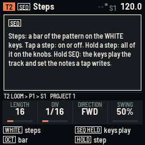

| Control | What it does |
| --- | --- |
| **SEQ** | Steps. On the FM-1, hold it and the keys play the track and set the notes a step press writes. |
| **EDIT** | Track: the device, channel, ports and transpose; page 2: type, program, in key or lane note, velocity. |
| **ENV** | Lanes: page 1 picks each lane's CC, page 2 plays them live. |
| **FX** [KNOB BANK] | Perform: mutes, solo, fill. |
| **LFO** | Overview: every track's length and playhead. |
| **ARP** | Generate: Euclid and random patterns. ARP again prints the one shown into the pattern. |
| **GLO** | Global: clock and tempo, key and scale, ports, projects, about. |
| **HOME** | Arrange; press it again for the Song. Held, it is a shift. |
| **SEL** | The page's menu. In a menu, SEL does the item and HOME closes it. |
| **SAVE** | Saves the project into its slot. While playing, it saves when you stop. |
| **PLAY** | Starts and stops. REC held + PLAY: play and record. On the Song page: the song from the slot picked. |
| **REC** | Playing: recording on or off. Stopped: step record. |
| **ALGORITHM** | The track. |
| **PRESETS** | The track's pattern, at the next bar. On a drum track's Steps page: the drum lane. |
| **SELECT** | The page's next page (the dots at the right of the tag line). With a step held: its group. In a menu: the item. |
| **KNOB 1-4** | The four values at the bottom of the screen. |
| **OCT- / OCT+** | FM-1: the bar shown on Steps; with SEQ held or on pages without steps, the keys' octave. SMK-37: the keybed's octave. |
| **< / >** (SMK-37) | The bar shown on Steps; with a step held, its group; in step record, back and a rest. |
| **FADER BANK** (SMK-37) | Held: fill, on any page. |
| **HOME + SEL** | Undo the last pattern change (again: redo). |
| **HOME + GLO** | All notes off, on every channel and port. |
| **HOME + PRESETS** | The next scene. |
| **HOME + SEQ / EDIT** | Copy / paste the pattern. |
| **HOME + ARP** | Print the generator, from any page. |

**The SMK-37's own controls.**
- The 37-key keybed always plays the selected track, with velocity.
- The 16 pads are the page's 16 keys: steps, scenes, mutes or tracks. Steps 1-8 are the top row.
- The four faders play lanes 1-4 live.
- The pitch and mod wheels go to the selected track.
- The TRS jack is MIDI out.

## The screen

From top to bottom:
- **The header:** the track's colour and number, the page, then MIDI activity, a red dot while recording, the play
  triangle, the scene and the tempo. The tempo is green while it follows a clock coming in. `*` means unsaved
  changes; SAVE AT STOP means a save is waiting.
- **The page.**
- **The tag line:** where you are (track, device, pattern, scene, project), with the page's dots on the right.
- **The four knobs.**
- **Two lines of hints:** what the keys and buttons do here.

Messages cover the header for a moment.

Every track keeps its colour. Cream outlines show what you are holding, and red is used only for recording and locks.

## Steps

Press **SEQ**. The 16 white keys [pads] are one bar of the selected track's pattern. The squares at the top right are
the pattern's bars: OCT- / OCT+ [< >] show the others, and a line under one marks the bar playing.

- **Tap a step** to put the remembered notes on it, or to clear it. The remembered notes are the last keys you played
  together on this track.
- **Hold a step** to see everything about it (below).
- **Hold several steps** and turn a knob: they all change.
- **Hold a step and play keys** (FM-1: with SEQ held) [the keybed] to give it those notes. Play a chord to give it a
  chord.

A cell shows its notes: the first by name, then "+2" for two more. Small marks show:
- ratchet ticks;
- a condition (1:2, FILL...) or a chance in %;
- a dash for glide;
- a red dot for a lock;
- a cream line at the top for micro-timing.

The knobs set the pattern's **LENGTH** (1-64 steps), **DIV** (a step's note value: 1/32, 1/16T, 1/16, 1/8T, 1/8,
1/4T, 1/4, 1/2, a bar), **DIRECTION** (forward, reverse, ping-pong, random) and **SWING** (50-75 %: every second
step later).

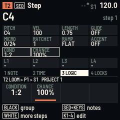

**A held step's four groups.** Black keys 1-4 [< >] pick a group; SELECT also turns through them. The outlined group
is what the knobs edit:

| Group | KNOB 1 | KNOB 2 | KNOB 3 | KNOB 4 |
| --- | --- | --- | --- | --- |
| NOTE | pitch (moves every note) | velocity | length, in quarter steps | glide (into the next step) |
| TIME | micro: -11 to +11 twenty-fourths of a step | ratchet: 1 to 8 hits | ramp: flat, up, down | accent (velocity 127) |
| LOGIC | condition | chance, % | | |
| LOCKS | lane 1's value | lane 2's | lane 3's | lane 4's |

A lock turned below 0 goes off: the lane keeps its value at that step.

**Conditions:**
- **A:B**, from 1:2 to 8:8: plays on pass A of every B.
- **FILL / !FILL**: only while FILL is held, or only while it isn't.
- **PRE / !PRE**: only if this track's last conditional step played, or didn't.
- **NEI / !NEI**: the same for the track before.
- **1ST / !1ST**: only on the pattern's first pass, or never on it.

**Drum tracks.** On a drum track the page shows the lanes as rows. Pick a lane with a black key [PRESETS, or that
drum's key on the keybed]; the lane's sound plays as you pick it. A tap adds or removes that lane's hit, so up to four
drums can share a step. A brighter cell is a harder hit.

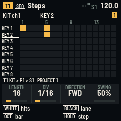

**The menu** (SEL):
- copy and paste the pattern;
- clear it;
- double it (its steps again after itself, up to 64);
- shift it one step left or right;
- undo the last of these.

## Recording

- **Live:** press REC while playing, or hold REC and press PLAY. What you play goes onto the nearest step, with its
  length. This includes the FM-1's keys (they play notes while recording), the keybed, and MIDI coming in. On the
  Lanes page, knobs [faders] write locks while recording. Press REC again to stop recording.
- **Step record:** press REC while stopped. A red cursor shows the step. Play a note or a chord: it goes on the step,
  and the cursor moves on. OCT+ [>] leaves a rest, OCT- [<] goes back, and a step key moves the cursor there. Press
  REC to finish.

## Track

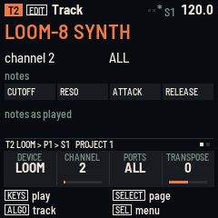

Press **EDIT**.

| Page | KNOB 1 | KNOB 2 | KNOB 3 | KNOB 4 |
| --- | --- | --- | --- | --- |
| 1 | DEVICE: the profile; picking one sets the track's type, lanes and drum notes | CHANNEL: 1-16 | PORTS: ALL, USB, BLUETOOTH, BT DEVICE, BT HOST (SMK-37: also USB+TRS, TRS) | TRANSPOSE: ±24 semitones |
| 2 | TYPE: notes or drums | PROGRAM: a program change at PLAY and when a scene starts the track, or none | IN KEY: notes snap to the key; on a drum track, LANE NOTE: the MIDI note of the lane picked on Steps | VELOCITY: a new step's |

The menu resets the track, and copies and pastes the pattern.

## Lanes

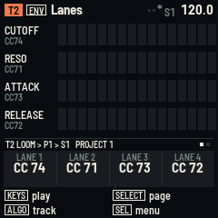

Press **ENV** [CHORD].
- **Page 1:** sets what each of the four lanes sends: off, CC 0-127, pitch bend or pressure. The page shows each
  lane's name and this bar's locks.
- **Page 2:** the four knobs play the lanes now, and write locks while recording. On the SMK-37 the four faders play
  lanes 1-4 on every page.

## Perform

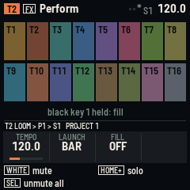

Press **FX** [KNOB BANK].
- The 16 white keys [pads] mute and unmute the tracks.
- Hold HOME and press one to solo it; solo several to hear only those.
- **FILL** is on while black key 1 is held [FADER BANK, from any page]. KNOB 3 latches it on.
- A mute is kept in the scene playing.
- The menu unmutes everything.

## Overview

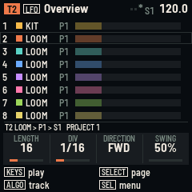

Press **LFO** [NOTE REPEAT].
- Eight tracks show at once: the half that holds the selected track. Each has its pattern, its length as a bar and
  its playhead, so tracks of different lengths can be seen drifting.
- The white keys [pads] pick a track; the black keys mute tracks 1-11.
- The knobs edit the selected track's pattern, as on Steps.

## Generate

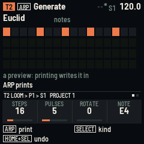

Press **ARP**.
- **Page 1, Euclid:** STEPS, PULSES and ROTATE spread the hits as evenly as they go.
- **Page 2, Random:** DENSITY, RANGE (semitones above the note) and SEED.
- **KNOB 4:** the note (or, on a drum track, the lane) the generator writes.

The grid previews the result. Press **ARP** again (or SEL > PRINT) to write it into the pattern; HOME + SEL undoes
it. On a drum track only the lane's hits change. Random notes keep to the key when the scale isn't chromatic.

## Arrange and the song

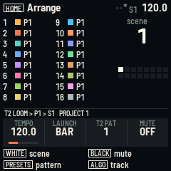

Press **HOME** [PATCH].
- **Scenes:** the white keys [pads] are scenes 1-16. While playing, a scene starts at the next bar; press its key
  again to start it at once. An empty scene's key makes it a copy of what is playing.
- **Changing a scene:** change patterns (PRESETS, or KNOB 3 here) and mutes, and the scene playing keeps them.
- **Mutes:** the black keys mute tracks 1-11.
- **Knobs:** TEMPO (hold HOME for tenths), LAUNCH (at the bar, or now), the selected track's PATTERN, and its MUTE.
- **The menu:** copy, paste and clear the scene.

Press **HOME** again for the **Song**:
1. Pick a slot with KNOB 1.
2. Press a scene's key to add it after that slot.
3. Set the slot's scene and its bars (1-64) with KNOB 2 and 3. KNOB 4 decides whether the song loops or stops at the
   end.
4. PLAY on this page plays the song from the slot picked.

The song changes scene at the bar. The menu plays the song from the slot picked, deletes a slot and clears the song.

## Global

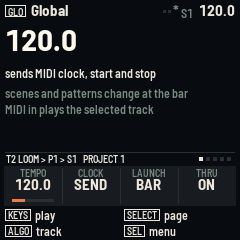

Press **GLO** [GLOBE] and turn SELECT through six pages:

| Page | KNOB 1 | KNOB 2 | KNOB 3 | KNOB 4 |
| --- | --- | --- | --- | --- |
| 1 Clock | TEMPO, 30-300 | CLOCK: internal, send (clock, start and stop on every port), receive (follows a clock coming in; its own tempo while none comes) | LAUNCH: at the bar, or now | THRU: MIDI coming in plays the selected track |
| 2 Key | ROOT | SCALE (12) | KEYS OCT: the keys' octave | |
| 3 Ports | USB: DEVICE (a computer), or HOST (a synth or an FM-1 through a powered hub) | BLUETOOTH: OFF, ON, or AUTO (on, and back to the last device by itself) | BT DEVICE: picks one of those around; SEL > BT CONNECT connects or lets it go | [TRS OUT on or off] |
| 4 Timing | PORT: USB [USB+TRS], BT HOST or BT DEVICE | NOTES: that port's notes and CCs, -120 to +120 ms | CLOCK AT: its clock the same way | CLOCK: off, clock, or +start (clock, start and stop) |
| 5 Projects | SLOT: the four slots (below) | | | |
| 6 About | the version, and the MIDI messages in and out on each port | | | |

The Ports page lists the Bluetooth devices around, with their signal strength, and shows a passkey when a device
asks for one: type it on the device. The Timing page is explained below.

## Saving and the four projects

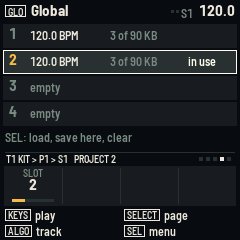

**SAVE** [BT] saves the project into its slot.
- **While playing:** writing the flash would stop everything for a moment, so the header says SAVE AT STOP, and the
  project saves as soon as the playing stops. That includes a stop sent by a clock coming in.
- **The four slots:** GLOBAL page 5 lists them, each with its tempo and size. Pick one with KNOB 1, then SEL.
- **LOAD PROJECT** loads it, asking first if what is playing has unsaved changes.
- **SAVE HERE** saves into it, and it becomes the slot in use. It asks first if the slot holds another project.
- **CLEAR SLOT** empties it, asking first.
- **At power-on**, the slot in use comes back.
- **NEW PROJECT** (in every menu) starts afresh in the same slot, and asks first.
- **Slot size:** about 90 KB on the FM-1 and 56 KB on the SMK-37, which is about 5,700 and 3,500 steps in use. A
  project bigger than that says TOO BIG FOR A SLOT and writes nothing.

## Playing a LOOM-8 FM-1

LOOM-8's tracks 1-8 listen on channels 1-8, and a new RELAY-16 project matches: T1 drives the kit, T2-T8 the synths.
- **Clock:** RELAY-16 sends clock, start and stop, and LOOM-8 follows with its CLOCK on *receive* (its default). So
  LOOM-8's own sequencer starts and stops too: keep its patterns empty, or let them play along.
- **Knobs:** the LOOM-8 profiles name LOOM-8's knobs: cutoff, resonance, attack, release, level, pan, the sends and
  the LFO amount.
- **Chords:** a LOOM-8 step holds 4 notes, as RELAY-16's does.
- **Recording it in:** hold REC on the LOOM-8 while it plays, and it records what RELAY-16 sends into its own
  patterns.
- **LOOM-8's scenes:** a track on channel 11 with a PROGRAM switches LOOM-8 to scene PROGRAM.
- **The kit's notes:** T1 sends LOOM-8's eleven drum keys as the notes of its black keys, F#3 to F#5. That mapping
  hasn't been checked on a unit. If a lane plays the wrong drum, set its note on TRACK page 2 (LANE NOTE).

## Two LOOM-8s, and other firmwares over Bluetooth

RELAY-16 has two links at once: USB (or, on an SMK-37, the TRS jack, which carries the same stream) and one Bluetooth
MIDI device. Each track picks its channel and its ports, so the 16 tracks can be split between two instruments.

**Two LOOM-8 FM-1s, all 16 tracks.** Each LOOM-8 needs channels 1-8, so each takes a link of its own:
1. LOOM-8 A on USB (GLOBAL page 3, USB to HOST, a powered hub) or on the SMK-37's TRS jack: T1-T8 as they are.
2. LOOM-8 B on Bluetooth: GLOBAL page 3, pick it with KNOB 3, then SEL > BT CONNECT. With BLUETOOTH on AUTO,
   RELAY-16 connects to it again by itself at power-on and whenever the link drops.
3. T9-T16: on TRACK, give them channels 1-8 and set PORTS to BT DEVICE. Give T9 the LOOM-8 KIT device.

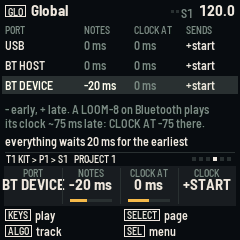

**Timing (GLOBAL page 4).** Bluetooth takes its time. Notes reach a Bluetooth device 10-20 ms after USB's, and a
LOOM-8 plays a clock that comes over Bluetooth by its timestamps, about 75 ms late on purpose. Its notes play as they
arrive. So each port's notes and clock can go early (minus) or late (plus):
- **Notes for LOOM-8 B:** PORT to BT DEVICE, then NOTES to about -15 ms. Tune it by ear against LOOM-8 A: a fast
  hi-hat on both shows the gap.
- **Clock for LOOM-8 B:** CLOCK AT to -75 ms, so its own sequencer, arpeggios and tempo effects line up.
- **How early works:** nothing can be sent before the music happens, so everything RELAY-16 sends waits as long as
  the earliest setting, and the others go that much later. The page says how long. The keys you play live go at
  once.

**Other firmwares.** A firmware that starts its own sequencer when it hears a MIDI start can be given the clock
without start and stop (CLOCK: clock), or no clock at all (CLOCK: off). Any program change a track has is sent again
when its device connects, and a passkey a device asks for is shown on GLOBAL page 3. A firmware that listens on fixed
channels needs its own link: on one link, a LOOM-8 reacts to almost every channel (1-8 its tracks, 9-10 its effects,
11 its scenes, 12-16 its selected track).

**Limits.** One device on USB at a time, and one Bluetooth link: while RELAY-16 is connected to a Bluetooth device, a
computer can't connect to it over Bluetooth. FM-1 to FM-1 over Bluetooth has only been tested in fm1-base's
simulation.

## MIDI

- **Out:** each track's notes, locks, lanes and program changes go out on its channel to its ports, each port at its
  own timing (GLOBAL page 4). The SMK-37's TRS jack carries everything USB sends, and also tracks set to TRS alone.
  With CLOCK on *send*, clock, start and stop go to every port that takes them (GLOBAL page 4, CLOCK).
- **In:** notes from USB, Bluetooth and (FM-1) the TRS jack play the selected track when THRU is on, and record
  while recording. With THRU on, pitch bend, pressure and CCs go to the selected track's channel too.
- **Clock in:** with CLOCK on *receive*, clock, start, continue and stop drive RELAY-16.
- **Stopping:** every note-off still owed is sent. HOME + GLO also sends All Notes Off on every channel.

## Installing and going back

- **From the browser:** use the [site](../), with Chrome or Edge on a computer. Choose your unit's page; it checks
  that the package is the right one for the unit connected.
- **From the command line:** `python3 tools/fm1_install.py FILE.fwsc` (from fm1-base, with python-rtmidi).
- **Going back:** M-VAVE's updater, M-UPGRADE, installs the stock firmware at any time.
- **A unit that doesn't start:** hold OCT- [OCTAVE-] while switching on for the update mode, then install again.
- **What RELAY-16 writes:** only its own windows of the flash. On the SMK-37, fm1-base's board layer never writes the
  calibration, the Bluetooth pairing or the key areas. Going back to the stock firmware rebuilds its key mapping.
