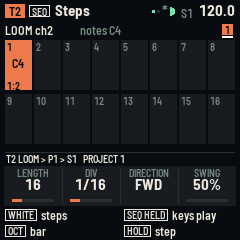
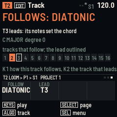
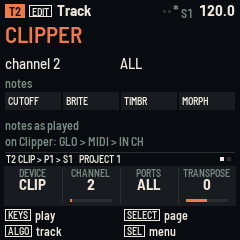
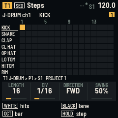

# RELAY-16 manual

RELAY-16 turns the M-VAVE FM-1 or SMK-37 into a sequencer for other instruments. It makes no sound of its own: its
sixteen tracks play other gear over MIDI. This manual covers both units. Where the SMK-37 differs, its controls are in
brackets.

**Status:** version 0.6 has not been tried on a unit yet. It builds for both boards and passes its tests in
fm1-base's simulator. Keep M-VAVE's stock firmware and its updater, M-UPGRADE, at hand.

- [Quick start: a beat on a LOOM-8 FM-1](#quick-start-a-beat-on-a-loom-8-fm-1)
- [The words](#the-words)
- [The controls](#the-controls)
- [The screen](#the-screen)
- [Five things to try](#five-things-to-try)
- [Steps](#steps)
- [How a step plays](#how-a-step-plays)
- [Patterns, time and polymeter](#patterns-time-and-polymeter)
- [Recording](#recording)
- [Track](#track)
- [Device profiles](#device-profiles)
- [The conductor](#the-conductor)
- [Lanes](#lanes)
- [Perform](#perform)
- [Overview](#overview)
- [Generate](#generate)
- [Arrange and the song](#arrange-and-the-song)
- [Global](#global)
- [The clock](#the-clock)
- [Shortcuts and menus](#shortcuts-and-menus)
- [Saving and the four projects](#saving-and-the-four-projects)
- [Playing a LOOM-8 FM-1](#playing-a-loom-8-fm-1)
- [Two LOOM-8s, and other firmwares over Bluetooth](#two-loom-8s-and-other-firmwares-over-bluetooth)
- [JIANT FM and Clipper](#jiant-fm-and-clipper)
- [MIDI](#midi)
- [Troubleshooting](#troubleshooting)
- [Installing and going back](#installing-and-going-back)

## Quick start: a beat on a LOOM-8 FM-1

1. **Set up the LOOM-8 FM-1.** Start a new project and leave CLOCK on *receive*.
2. **Connect.** From an SMK-37: a 3.5 mm TRS cable from its jack into the FM-1's MIDI IN. From an FM-1: press GLO,
   turn SELECT to page 3, turn KNOB 1 to HOST, and join the two FM-1s through a powered USB hub.
3. **A beat.** Press SEQ. Track 1 drives LOOM-8's kit. Press a black key to pick a drum [turn K8, or play the drum's
   key on the keybed]. Then press white keys [pads] to place hits. Press PLAY: the LOOM-8 plays it.
4. **A bass line.** Turn ALGORITHM [K7] to T2. Hold SEQ and play a note on the keys [play the keybed]. Let go and
   tap steps: each one gets that note.
5. **Shape a step.** Hold a step. Press black key 3 [SELECT, or < >] for LOGIC, then turn KNOB 1 to 1:2: the step
   plays every other pass.
6. **Move the sound.** Press ENV [CHORD] and turn SELECT to page 2. KNOB 1 now moves LOOM-8's cutoff on T2 [so does
   fader 1].
7. **Save.** Press SAVE [BT].

Not sure what a button does? Hold it for a second: a card explains it.

## The words

- **Track** (T1 to T16): one part. A track sends on one MIDI channel to the ports you pick, and has 8 patterns.
- **Pattern** (P1 to P8): a track's steps, up to 64, with its own length, note value, direction and swing.
- **Step**: up to 4 notes and everything about how they play.
- **Lane**: one of a track's four CCs (or pitch bend, or pressure). A step can **lock** a lane to a value.
- **Device profile**: what a track drives (LOOM-8 synth, LOOM-8 kit, JIANT synth, JIANT DRUM-X, Clipper, GM drums,
  a drum machine, the stock FM-1, a generic synth). It names the lanes and the drum notes.
- **Scene** (S1 to S16): a pattern and a mute for every track.
- **Song**: scenes in order, each for a number of bars.
- **Project**: all of it. There are four slots.

## The controls

On the SMK-37 the buttons carry their own names:

| FM-1 | SMK-37 |
| --- | --- |
| SEL | SCALE |
| ENV | CHORD |
| LFO | NOTE REPEAT |
| EDIT | PARA |
| GLO | GLOBE |
| HOME | PATCH |
| SAVE | BT |
| PLAY | SEQ PLAY |
| REC | SEQ REC |
| SELECT | K6 |
| ALGORITHM | K7 |
| PRESETS | K8 |
| KNOB 1-4 | K1-K4 |

The screen always uses the names printed on your unit.

**Help cards.** Hold any button on its own for a second and a card explains it, in your unit's names. Let go and the
card goes, and nothing else happens. A button that acts when pressed (PLAY, REC, SAVE, a page) has still done so. A
button held while you use another control is a shift, and shows no card. FADER BANK shows none: it is held for fills.

| Control | What it does |
| --- | --- |
| **SEQ** | Steps. On the FM-1, hold it and the keys play the track and set the notes a step press writes. |
| **EDIT** | Track: the device, channel, ports and transpose; page 2: type, program, in key or lane note, velocity; page 3: the conductor. |
| **ENV** | Lanes: page 1 picks each lane's CC, page 2 plays them live. |
| **FX** [KNOB BANK] | Perform: mutes, solo, fill. |
| **LFO** | Overview: every track's length and playhead. |
| **ARP** | Generate: Euclid and random patterns. ARP again prints the one shown into the pattern. |
| **GLO** | Global: clock and tempo, key and scale, ports, projects, about. |
| **HOME** | Arrange; press it again for the Song. Held, it is a shift. |
| **SEL** | The page's menu. In a menu, SEL does the item and HOME closes it. |
| **SAVE** | Saves the project into its slot. While playing, it saves when you stop. |
| **PLAY** | Starts and stops. REC held + PLAY: play and record. On the Song page: the song from the slot picked. |
| **REC** | Playing: recording on or off. Stopped: step record. |
| **ALGORITHM** | The track. |
| **PRESETS** | The track's pattern, at the next bar. On a drum track's Steps page: the drum lane. |
| **SELECT** | The page's next page (the dots at the right of the tag line). With a step held: its group. In a menu: the item. |
| **KNOB 1-4** | The four values at the bottom of the screen. |
| **OCT- / OCT+** | FM-1: the bar shown on Steps; with SEQ held or on pages without steps, the keys' octave. SMK-37: the keybed's octave. |
| **< / >** (SMK-37) | The bar shown on Steps; with a step held, its group; in step record, back and a rest. |
| **FADER BANK** (SMK-37) | Held: fill, on any page. |
| **HOME + SEL** | Undo the last pattern change (again: redo). |
| **HOME + GLO** | All notes off, on every channel and port. |
| **HOME + PRESETS** | The next scene. |
| **HOME + SEQ / EDIT** | Copy / paste the pattern. |
| **HOME + ARP** | Print the generator, from any page. |

**The SMK-37's own controls.**
- The 37-key keybed always plays the selected track, with velocity.
- The 16 pads are the page's 16 keys: steps, scenes, mutes or tracks. Steps 1-8 are the top row.
- The four faders play lanes 1-4 live.
- The pitch and mod wheels go to the selected track.
- The TRS jack is MIDI out.

## The screen

From top to bottom:
- **The header:** the track's colour and number, the page, then MIDI activity, a red dot while recording, the play
  triangle, the scene and the tempo. The tempo is green while it follows a clock coming in. `*` means unsaved
  changes; SAVE AT STOP means a save is waiting.
- **The page.**
- **The tag line:** where you are (track, device, pattern, scene, project), with the page's dots on the right.
- **The four knobs.**
- **Two lines of hints:** what the keys and buttons do here.

Messages cover the header for a moment.

Every track keeps its colour. Cream outlines show what you are holding, and red is used only for recording and locks.

**The keys as a keyboard (FM-1).** The 27 keys play notes on the Track, Lanes, Generate and Global pages, while SEQ is
held, during step record, and while recording plays. Key 1 is F3 at KEYS OCT 0 (GLOBAL page 2), and OCT- / OCT+ move
the octave while the keys play. On the SMK-37 the keybed always plays, from C3 at octave 0; OCTAVE- / OCTAVE+ move it.

## Five things to try

Each of these takes a minute, and together they cover most of what RELAY-16 does. They assume a synth or a LOOM-8 is
listening on channels 1-3.

**1. A bass line that breathes.** Turn ALGORITHM [K7] to T2. Hold SEQ and play a low C [play it on the keybed], then
tap steps 1, 4, 7, 11 and 13 [pads 1, 4, 7, 11, 13]. Hold step 13, press black key 3 [SELECT] for LOGIC, and turn
KNOB 1 to 1:2: it plays every other pass. Hold step 7, press black key 2 [SELECT] for TIME and turn KNOB 2 to 3: a three-hit ratchet. Press PLAY.

**2. A chord part that leads, and a bass that follows.** On T3, hold SEQ and play a C major chord [play it on the
keybed]; tap step 1. Play G major; tap step 9. Press EDIT and turn SELECT to page 3; turn KNOB 2 to T3. Turn ALGORITHM
to T2, and on the same page turn KNOB 1 to DIATONIC. Press PLAY: the bass line from step 1 now moves to G for the
second half of the bar. Try HARMONY instead: the bass snaps onto the chord's own tones.

**3. Two lengths against each other.** On T1 (the kit) leave the pattern at 16 steps. On T2 press SEQ and turn KNOB 1
to 12: the bass loops every twelve steps against the drums' sixteen, and comes round to the downbeat every three bars.
Turn KNOB 2 to 1/8T on a third track for a triplet feel over both.

**4. A filter that moves by itself.** On T2 press ENV [CHORD]: lane 1 is CUTOFF on the LOOM-8 and generic profiles.
Press PLAY, press REC, turn SELECT to page 2 and turn KNOB 1 [move fader 1] while it plays: each step the playhead
passes takes the value as a lock, shown red on the Lanes page. Press REC to stop recording; the sweep stays. Hold a
step and press black key 4 [SELECT] for LOCKS to see or change its value.

**5. Scenes and a song.** Press HOME [PATCH]. Press white key 2 [pad 2]: scene 2 is a copy of scene 1. Turn PRESETS
[K8] to give T2 pattern 2, press SEQ and write something different. Press HOME: the keys now switch scenes at the bar.
Press HOME again for the Song page: press white key 1, then white key 2, and set each slot's bars with KNOB 3. PLAY on
this page plays the song.

## Steps

Press **SEQ**. The 16 white keys [pads] are one bar of the selected track's pattern. The squares at the top right are
the pattern's bars: OCT- / OCT+ [< >] show the others, and a line under one marks the bar playing.

- **Tap a step** to put the remembered notes on it, or to clear it. The remembered notes are the last keys you played
  together on this track.
- **Hold a step** to see everything about it (below).
- **Hold several steps** and turn a knob: they all change.
- **Hold a step and play keys** (FM-1: with SEQ held) [the keybed] to give it those notes. Play a chord to give it a
  chord.

A cell shows its notes: the first by name, then "+2" for two more. Small marks show:
- ratchet ticks;
- a condition (1:2, FILL...) or a chance in %;
- a dash for glide;
- a red dot for a lock;
- a cream line at the top for micro-timing.

The knobs set the pattern's **LENGTH** (1-64 steps), **DIV** (a step's note value: 1/32, 1/16T, 1/16, 1/8T, 1/8,
1/4T, 1/4, 1/2, a bar), **DIRECTION** (forward, reverse, ping-pong, random) and **SWING** (50-75 %: every second
step later).

**A held step's four groups.** Black keys 1-4 [< >] pick a group; SELECT also turns through them. The outlined group
is what the knobs edit:

| Group | KNOB 1 | KNOB 2 | KNOB 3 | KNOB 4 |
| --- | --- | --- | --- | --- |
| NOTE | pitch (moves every note) | velocity | length, in quarter steps | glide (into the next step) |
| TIME | micro: -11 to +11 twenty-fourths of a step | ratchet: 1 to 8 hits | ramp: flat, up, down | accent (velocity 127) |
| LOGIC | condition | chance, % | | |
| LOCKS | lane 1's value | lane 2's | lane 3's | lane 4's |

A lock turned below 0 goes off: the lane keeps its value at that step.

**Conditions:**
- **A:B**, from 1:2 to 8:8: plays on pass A of every B.
- **FILL / !FILL**: only while FILL is held, or only while it isn't.
- **PRE / !PRE**: only if this track's last conditional step played, or didn't.
- **NEI / !NEI**: the same for the track before.
- **1ST / !1ST**: only on the pattern's first pass, or never on it.

**Drum tracks.** On a drum track the page shows the lanes as rows. Pick a lane with a black key [PRESETS, or that
drum's key on the keybed]; the lane's sound plays as you pick it. A tap adds or removes that lane's hit, so up to four
drums can share a step. A brighter cell is a harder hit.

**The menu** (SEL):
- copy and paste the pattern (the pattern's length, note value, direction and swing go with it);
- clear it;
- double it (its steps again after itself, up to 64);
- shift it one step left or right;
- undo the last of these.

**Writing notes, the three ways.** A tap writes the remembered notes, which are the last keys you played together on
this track (a single key, or a chord of up to four). Holding a step while you play writes exactly what you play on it:
the first key replaces the step's notes, the next keys add to them. Step record (below) writes a step at a time.
Pitch, on a held step's NOTE group, moves every note of the step together.

**Several steps at once.** Hold two or more steps and every knob turn applies to all of them, group by group. Nothing
toggles on release once you have held two, so you can hold a whole row and set its velocity in one move.

## How a step plays

Half a step before its line, each track judges the step that comes next: its condition, its chance, and whether the
track is heard. What passes is placed in a queue with its note-offs, so a step moved early by micro-timing is still on
time, and a note always ends before the same note starts again on the same channel.

- **Length** is in quarter steps: 4 is exactly one step, 3 (a new step's) leaves a gap, 16 holds through four steps.
  A gate shorter than one tick is made one tick long.
- **Glide** makes the gate at least a step and a quarter, so the notes overlap the next step: on a mono synth that is
  legato, and portamento if the synth glides on overlapping notes.
- **Ratchet** divides the step into 2-8 hits. Each hit's gate is at most three quarters of its share, so the hits
  stay apart. **Ramp** shapes their velocities: UP grows from soft to the step's velocity, DOWN falls from it.
- **Accent** sends velocity 127 whatever the step's velocity. On a drum track the bright cells are hits at 100 or
  more, or accented.
- **Micro** moves the step by up to eleven twenty-fourths of a step either way. A step moved so early that its time
  has already passed (right after PLAY, or just after a pattern change) plays at once.
- **Swing** delays the second step of each pair: at 75 % it lands half a step late, which turns straight sixteenths
  into a shuffle. It counts the steps the track has judged, so it keeps its feel in reverse and ping-pong too.
- **Chance** is rolled only for steps that have notes and only after the condition has passed. A step of locks alone
  always sends them.
- **Locks** are sent before the notes of the same step, so a cutoff lock shapes the note it sits on.
- **Mutes** are judged at the same moment: a step a muted track would have played is skipped, note-offs excepted,
  and the track's playhead still moves.

**Conditions, exactly.** The pass count starts at 0 when the pattern starts or restarts (PLAY, a scene change, a
pattern change at the bar).
- **A:B** plays on pass A of every group of B passes: 1:2 is the first, third and fifth pass; 2:2 the second,
  fourth and sixth; 3:4 the third of every four.
- **FILL** plays while FILL is on: black key 1 held on Perform, FADER BANK held anywhere on the SMK-37, or KNOB 3 on
  Perform latched. **!FILL** plays while it is off, so a bar can swap between two parts.
- **PRE** plays if this track's last step with a condition or a chance played; **!PRE** if it did not. A step with a
  chance of 50 % followed by a PRE step makes a two-step phrase that comes and goes together.
- **NEI** looks at the track before (T2's NEI is T1's last conditional step). T1 has no track before it, so its NEI
  never plays and its !NEI always does.
- **1ST** plays only on the first pass after a start; **!1ST** on every other. A pattern change at the bar starts the
  count again, so 1ST is a pick-up into a new section.

## Patterns, time and polymeter

Each track has eight patterns, and each pattern keeps its own LENGTH (1-64 steps), DIV (its note value), DIRECTION
and SWING. The time base is 96 ticks a quarter note; a bar line comes every 16 sixteenths whatever the patterns are
doing, and every note value divides it evenly.

- **DIV** sets what a step is worth: 1/16 is the usual, 1/32 doubles the speed, 1/8 halves it, a bar makes a
  step a bar long (a chord pad), and the triplet values (1/16T, 1/8T, 1/4T) put three steps where two would go.
- **Lengths that differ** drift against each other and come round together after their least common multiple: 16
  against 12 every three bars, 16 against 15 every fifteen. The Overview page shows the playheads drifting.
- **Direction.** REV starts from the last step. PING goes up and back without repeating the end steps. RAND picks a
  step at random every time, and counts a pass every LENGTH steps for the conditions.
- **Changing pattern.** PRESETS [K8] cues the next pattern; with LAUNCH on BAR it starts at the next bar line, with
  LAUNCH on NOW at once (the playhead stays where it is unless the new pattern is shorter). The Arrange page shows a
  cued pattern as P1>P2. While stopped, the change is immediate.
- **Bars on the Steps page.** A pattern longer than 16 steps has bar tabs at the top right; OCT- / OCT+ [< >] show
  them, and the line under a tab marks the bar playing. Steps past the length are dark and do nothing.
- **A pattern's settings travel with it:** copy, paste, double and the generators carry or change them (Euclid's print
  sets the length to STEPS).

## Recording

- **Live:** press REC while playing, or hold REC and press PLAY. What you play goes onto the step the playhead is on,
  with the velocity you played and, when you let go, the length you held it (in quarter steps, so a held note becomes
  a long gate). Notes played together land on the same step, up to four; a fifth is dropped. A step that already has
  notes takes the new one alongside. This includes the FM-1's keys (they play notes while recording), the keybed, and
  MIDI coming in. Press REC again to stop recording; the header's dot goes.
- **Lanes while recording:** on the Lanes page 2 the knobs [the faders, on every page] send the lane and write its
  value as a lock on the step playing, so a sweep over a bar becomes sixteen locks. A lock is kept until a step is
  cleared, or the Lanes menu clears them all.
- **Step record:** press REC while stopped. The Steps page opens with a red cursor on the first step of the bar shown.
  Play a note or a chord: when every key is up, it goes on the cursor's step (replacing what was there) and the cursor
  moves on, wrapping at the pattern's end. OCT+ [>] leaves a rest, OCT- [<] goes back, and a step key moves the cursor
  there. Press REC to finish. The notes play as you enter them, so you hear what you write.
- **Both record the selected track only.** Turn ALGORITHM [K7] to change it mid-take.

## Track

Press **EDIT**.

| Page | KNOB 1 | KNOB 2 | KNOB 3 | KNOB 4 |
| --- | --- | --- | --- | --- |
| 1 | DEVICE: the profile; picking one sets the track's type, lanes and drum notes | CHANNEL: 1-16 | PORTS: ALL, USB, BLUETOOTH, BT DEVICE, BT HOST (SMK-37: also USB+TRS, TRS) | TRANSPOSE: ±24 semitones |
| 2 | TYPE: notes or drums | PROGRAM: a program change at PLAY and when a scene starts the track, or none | IN KEY: notes snap to the key; on a drum track, LANE NOTE: the MIDI note of the lane picked on Steps | VELOCITY: a new step's |
| 3 | FOLLOW: how this track follows the conductor (below) | LEAD: the track that leads, or OFF | | |

The menu resets the track (its profile, lanes, drum notes, transpose, velocity and follow go back to the defaults;
the channel and ports stay), and copies and pastes the pattern.

**Transpose and IN KEY.** Transpose moves the track's notes before anything else, so a bass part written an octave
up plays where it should. IN KEY then snaps each note down to the nearest note of the key (GLOBAL page 2) when the
scale is not chromatic, so a part written in C major plays in D dorian when the key changes. Drum tracks ignore both.
Live keys and MIDI in go through the same two steps.

**Program changes.** A track's PROGRAM is sent when PLAY starts, when a scene starts the track, and again whenever
the device on a port connects (Bluetooth, the USB host), so an instrument that was switched on late still gets it.

## Device profiles

A profile is a starting point for a track: it sets the type, names the four lanes (and sets their CCs) and, for a
kit, names the drum lanes and sets their notes. Change any of it afterwards; the profile stays as the name on the
Track page and the tag line. New profiles are added at the end of the list, so a saved project keeps its tracks'
profiles.

| Profile | Type | Lanes 1-4 | Drum lanes |
| --- | --- | --- | --- |
| GENERIC SYNTH | notes | CUTOFF 74, RESO 71, MOD 1, VOLUME 7 | |
| LOOM-8 SYNTH | notes | CUTOFF 74, RESO 71, ATTACK 73, RELEASE 72 | |
| LOOM-8 KIT | drums | LEVEL 7, PAN 10, SEND I 91, SEND II 93 | KEY 1-11: F#3, G#3, A#3, C#4, D#4, F#4, G#4, A#4, C#5, D#5, F#5 |
| GM DRUMS | drums | VOLUME 7, PAN 10, REVERB 91, CHORUS 93 | KICK 36, SNARE 38, CLAP 39, CL HAT 42, OP HAT 46, LO TOM 45, HI TOM 50, RIM 37, CRASH 49, RIDE 51, COWBELL 56, TAMB 54, CONGA 63, SHAKER 70, CLAVE 75, PERC 76 |
| FM-1 STOCK | notes | CUTOFF 74, RESO 71, MOD 1, VOLUME 7 | |
| DRUM MACHINE | drums | VOLUME 7, PAN 10, MOD 1, CUTOFF 74 | LANE 1-16: notes 36-51 |
| JIANT SYNTH | notes | CUTOFF 74, RESO 71, E1 16, E2 17 | |
| JIANT DRUM-X | drums | VOLUME 7, CUTOFF 74, REVERB 91, DELAY 94 | KICK 36, SNARE 38, CLAP 39, CL HAT 42, OP HAT 46, LO TOM 45, HI TOM 50, RIM 37 |
| CLIPPER | notes | CUTOFF 74, BRITE 16, TIMBR 17, MORPH 20 | |

A new project gives T1 the LOOM-8 kit and T2-T8 the LOOM-8 synth, on channels 1-8; T9-T16 are generic synths on
channels 9-16. On a drum track the Steps page is a grid of the profile's lanes, the black keys [PRESETS, or the
drum's key on the keybed] pick the lane, and each lane's note can be changed on Track page 2 (LANE NOTE). The LOOM-8
kit's notes are a reading of LOOM-8's manual and have not been checked on a unit.

The Lanes page names any CC the profile knows: for the LOOM-8 profiles also LFO AMT 1, GLIDE 5, MUTE 9, DECAY 75
and the kit's LOW CUT 71, LENGTH 72 and HI CUT 74; for JIANT E1-E8 (16-23), DELAY 94, POST CUT 102, POST RES 103,
DRIVE 104 and SUSTAIN 105; for Clipper MOTN 18, SPACE 19, LFO RATE 76, VIBRATO 77, LFO FADE 78 and DELAY 94; and
for every profile MOD 1, BREATH 2, PORTA 5, VOLUME 7, PAN 10, EXPR 11, SUSTAIN 64, RESO 71, RELEASE 72, ATTACK 73,
CUTOFF 74, DECAY 75, REVERB 91 and CHORUS 93. Any other CC shows as its number.

## The conductor

LOOM-8's conductor, for other instruments: one track **leads**, and the others **follow** it, so a chord part or a
bass line on one track moves the rest through the key. Press **EDIT** and turn SELECT to page 3.

- **LEAD** (KNOB 2, the same on every track) picks the track whose notes set the chord: T1 to T16, or OFF. Each
  note it plays (all the notes on a step, or the keys held together on it) sets the chord. A single note is taken as
  the root of its triad in the key (in C major, C gives C E G and G gives G B D); two or more notes are the chord as
  played. The lowest note's place in the scale sets the **degree**, the nearer way: in C major a G takes the followers
  down a fourth and an F takes them up a fourth, so a bass line moves them as little as a chord would. The leading
  track plays as written, and still leads when muted. A drum track can't lead.
- **FOLLOW** (KNOB 1) sets how this track follows, steps and live keys alike. **NO**: as written. **DIATONIC**:
  each note moves by the degree along the key's scale (C major, lead on G: C4 becomes G3, E4 becomes B3).
  **TRANSPOSE**: the same distance in semitones, so a part keeps its shape and leaves the key where the chord does.
  **HARMONY**: each note snaps to the nearest tone of the chord itself, in its own register (ties go down).
  **CHORD DEG**: the note's place in the scale picks a chord tone (root, third, fifth, ... cycled), kept in the
  note's octave: a scale run becomes an arpeggio of the chord, and a repeated C plays the root of every chord.
- Drum tracks never follow. Until the lead has played, the degree is 0 and the harmony modes act as diatonic.
- The page shows the key, the degree and the chord the lead set, and the 16 tracks: the followers filled in their
  colour, the lead outlined.

**What a chord part should hold.** The lead's step holds the chord as you want the followers to hear it: three or
four notes for a full chord, or a single root for the triad the key implies (minor chords on the second, third and
sixth degrees of a major key, as a harmonisation would give). A chord that is not in the key (an E major in C major)
is taken as played by HARMONY and CHORD DEG, while DIATONIC and TRANSPOSE see only its root's degree. A step of the
lead with a condition that fails leaves the chord as it was; a rest does too.

**Which tracks to follow with.** Bass and pads follow well with DIATONIC; a melody that should keep its intervals
with TRANSPOSE; an arpeggio or a repeated figure with HARMONY or CHORD DEG. Leave the lead itself on NO (its own
mode is ignored while it leads), and a drum track on anything: it never moves.

**Live.** With THRU on, notes from MIDI in play the selected track through its follow mode too, so a keyboard
playing a follower stays in the chord. The keys held on the lead set the chord as they are played, so you can lead
by hand while it runs.

The lead is judged first on every tick, so a follower's step on the same line hears the chord. IN KEY (page 2) still
snaps a diatonic or transposed follower to the key; a harmony follower plays the chord's tones as they are. The lead
and each track's mode are saved with the project; a project from 0.5 loads with no lead and nothing following.

## Lanes

Press **ENV** [CHORD].
- **Page 1:** sets what each of the four lanes sends: off, CC 0-127, pitch bend or pressure. The page shows each
  lane's name and this bar's locks as red bars, with the playhead under them.
- **Page 2:** the four knobs play the lanes now, and write locks while recording. On the SMK-37 the four faders play
  lanes 1-4 on every page.

**What a lane sends.** A CC lane sends the CC on the track's channel to its ports. **BEND** sends pitch bend: 64 is
the centre, 0 the bottom and 127 the top of the synth's bend range, so a lock of 64 on a step puts the bend back.
**PRESS** sends channel pressure. A lane set to OFF keeps its locks but sends nothing, which is a way to mute a
sweep without losing it.

**Locks.** A step's four lock slots follow the four lanes, so changing a lane's CC on page 1 re-points every lock on
that lane. A lock is sent as its step is judged, before the step's notes, and only when the step plays (a condition
or a mute that stops the step stops its locks too). Between locks the synth keeps the last value it heard. The
Lanes menu clears every lock of the pattern (undo brings them back).

## Perform

Press **FX** [KNOB BANK].
- The 16 white keys [pads] mute and unmute the tracks.
- Hold HOME and press one to solo it; solo several to hear only those.
- **FILL** is on while black key 1 is held [FADER BANK, from any page]. KNOB 3 latches it on. Steps with the FILL
  condition play only then, and !FILL steps rest, so a fill is written as steps that wait for it.
- **Solo** overrides the mutes: while any track is soloed, only the soloed tracks are heard, and the mutes come back
  when the last solo goes. Solo is not saved; mutes are, in the scene playing.
- A tile lights in its colour as the track plays a step, so the page shows which tracks are busy.
- The menu unmutes everything and clears the solos.

## Overview

Press **LFO** [NOTE REPEAT].
- Eight tracks show at once: the half that holds the selected track. Each has its pattern, its length as a bar and
  its playhead, so tracks of different lengths can be seen drifting.
- The white keys [pads] pick a track; the black keys mute tracks 1-11.
- The knobs edit the selected track's pattern, as on Steps.

## Generate

Press **ARP**.
- **Page 1, Euclid:** STEPS, PULSES and ROTATE spread the hits as evenly as they go.
- **Page 2, Random:** DENSITY, RANGE (semitones above the note) and SEED.
- **KNOB 4:** the note (or, on a drum track, the lane) the generator writes.

The grid previews the result. Press **ARP** again (or SEL > PRINT) to write it into the pattern; HOME + SEL undoes
it. On a drum track only the lane's hits change. Random notes keep to the key when the scale isn't chromatic.

## Arrange and the song

Press **HOME** [PATCH].
- **Scenes:** the white keys [pads] are scenes 1-16. While playing, a scene starts at the next bar; press its key
  again to start it at once. An empty scene's key makes it a copy of what is playing.
- **Changing a scene:** change patterns (PRESETS, or KNOB 3 here) and mutes, and the scene playing keeps them.
- **Mutes:** the black keys mute tracks 1-11.
- **Knobs:** TEMPO (hold HOME for tenths), LAUNCH (at the bar, or now), the selected track's PATTERN, and its MUTE.
- **The menu:** copy, paste and clear the scene. Paste puts the copied patterns and mutes into the scene playing and
  cues them, so a whole arrangement can be moved to another scene.
- **How a scene starts.** With LAUNCH on BAR, each track switches at its next bar line and its pattern starts from
  the beginning, with its pass count at 0. The next scene is shown in green until every track has reached it. With
  LAUNCH on NOW every track restarts at once. HOME + PRESETS steps to the next scene from any page.
- **What a scene holds:** every track's pattern number and its mute. Not the steps: a pattern edited on one scene is
  edited on every scene that uses it.

Press **HOME** again for the **Song**:
1. Pick a slot with KNOB 1.
2. Press a scene's key to add it after that slot.
3. Set the slot's scene and its bars (1-64) with KNOB 2 and 3. KNOB 4 decides whether the song loops or stops at the
   end.
4. PLAY on this page plays the song from the slot picked.

The song changes scene at the bar: half a bar before a slot's bars are up, the next slot's scene is cued, so every
track hears it at the same bar line. A bar here is sixteen sixteenths whatever the patterns' lengths. The Song page
shows the slot playing in green with a bar counting across. The menu plays the song from the slot picked, deletes a
slot and clears the song. Pressing PLAY on any other page plays the scene, not the song. A scene key pressed while
the song plays cues that scene, but the song goes on to its next slot when the current one's bars are up.

## Global

Press **GLO** [GLOBE] and turn SELECT through six pages:

| Page | KNOB 1 | KNOB 2 | KNOB 3 | KNOB 4 |
| --- | --- | --- | --- | --- |
| 1 Clock | TEMPO, 30-300 | CLOCK: internal, send (clock, start and stop on every port), receive (follows a clock coming in; its own tempo while none comes) | LAUNCH: at the bar, or now | THRU: MIDI coming in plays the selected track |
| 2 Key | ROOT | SCALE (12) | KEYS OCT: the keys' octave | |
| 3 Ports | USB: DEVICE (a computer), or HOST (a synth or an FM-1 through a powered hub) | BLUETOOTH: OFF, ON, or AUTO (on, and back to the last device by itself) | BT DEVICE: picks one of those around; SEL > BT CONNECT connects or lets it go | [TRS OUT on or off] |
| 4 Timing | PORT: USB [USB+TRS], BT HOST or BT DEVICE | NOTES: that port's notes and CCs, -120 to +120 ms | CLOCK AT: its clock the same way | CLOCK: off, clock, or +start (clock, start and stop) |
| 5 Projects | SLOT: the four slots (below) | | | |
| 6 About | the version, and the MIDI messages in and out on each port | | | |

The Ports page lists the Bluetooth devices around, with their signal strength, and shows a passkey when a device
asks for one: type it on the device. The Timing page is explained below.

**Bluetooth, in detail.** RELAY-16 is both a Bluetooth MIDI device (a computer or phone connects to it: BT HOST) and
a central (it connects to one device: BT DEVICE). With BLUETOOTH on AUTO it remembers the last device it connected to
and looks for it at power-on and whenever the link drops, scanning twelve seconds in every twenty, and waiting ten
seconds after a try that failed. Letting a device go by hand (SEL > BT CONNECT / LET GO) pauses that until you pick a
device again. OFF switches the radio off, also for a computer. A device's programs are sent again when it connects.

**USB.** As DEVICE, RELAY-16 is a USB MIDI device for a computer, named RELAY-16. As HOST it drives a synth or
another FM-1 plugged into a powered hub (the FM-1's port gives no power), and a computer cannot connect meanwhile.
The Ports page says what is found: the device's name, HAS NO MIDI, NEEDS POWER or LOST.

**About** (page 6) shows the version and the board, and counts the MIDI messages in and out on USB, Bluetooth and
the TRS jack since power-on, which is the quickest check that a cable carries anything.

## The clock

RELAY-16's own clock runs at 96 ticks a quarter note from the unit's timer. GLOBAL page 1 sets how it relates to the
world:

- **SEND**: a MIDI clock (24 pulses a quarter note), START at PLAY and STOP at the stop go to every port whose CLOCK
  (page 4) is +START; a port set to CLOCK gets the pulses alone, so an instrument that starts its own sequencer on a
  START stays put; OFF gets nothing. This is the setting for a LOOM-8, JIANT or Clipper.
- **RECEIVE**: RELAY-16 follows a clock coming in on any port. START starts it from the top, CONTINUE carries on,
  STOP stops it (and a save waiting for the stop happens then). The tempo in the header turns green and shows the
  clock's tempo. The engine never runs ahead of the clock's next pulse and catches up gently behind it. When no pulse
  has come for half a second it runs at its own tempo again, so a DAW that stops sending clock does not freeze it.
- **INTERNAL**: its own tempo, no clock out, no clock in.

TEMPO goes from 30 to 300 in whole beats; HOME held makes the knob move in tenths. The tempo is the project's and is
saved with it. The time between steps is set by the pattern's DIV, so halving the tempo is not the same as doubling
every DIV: swing and micro-timing scale with the step.

## Shortcuts and menus

HOME [PATCH] held is a shift:

| Keys | Does |
| --- | --- |
| HOME + SEQ | copy the pattern |
| HOME + EDIT [PARA] | paste the pattern |
| HOME + ARP | print the generator from any page |
| HOME + SEL [SCALE] | undo, again: redo |
| HOME + GLO [GLOBE] | all notes off, every channel and port |
| HOME + PRESETS [K8] | the next scene (turn back: the one before) |
| HOME + a white key [pad] on Perform | solo that track |
| HOME + TEMPO | tenths; on the Timing page, 1 ms steps |

Undo keeps one step back: the last whole-pattern change (paste, clear, double, shift, print, clear locks). Undo
again redoes it. Edits to single steps are not undone.

Each page's menu (SEL [SCALE]) has its own items first, then SAVE PROJECT, NEW PROJECT and ALL NOTES OFF:

| Page | Items |
| --- | --- |
| Steps | copy, paste, clear, double, shift left, shift right, undo |
| Track | reset track, copy, paste |
| Lanes | clear locks, undo |
| Generate | print, undo |
| Perform, Overview | unmute all |
| Arrange | copy scene, paste scene, clear scene |
| Song | play song, delete slot, clear song |
| Global, Ports | BT connect / let go |
| Global, Projects | load project, save here, clear slot |

A question (NEW PROJECT?, REPLACE PROJECT?, CLEAR THE SLOT?, NOT SAVED: LOSE IT?) is answered with SEL again; any
other button says no.

## Saving and the four projects

**SAVE** [BT] saves the project into its slot.
- **While playing:** writing the flash would stop everything for a moment, so the header says SAVE AT STOP, and the
  project saves as soon as the playing stops. That includes a stop sent by a clock coming in.
- **The four slots:** GLOBAL page 5 lists them, each with its tempo and size. Pick one with KNOB 1, then SEL.
- **LOAD PROJECT** loads it, asking first if what is playing has unsaved changes.
- **SAVE HERE** saves into it, and it becomes the slot in use. It asks first if the slot holds another project.
- **CLEAR SLOT** empties it, asking first.
- **At power-on**, the slot in use comes back.
- **NEW PROJECT** (in every menu) starts afresh in the same slot, and asks first.
- **Slot size:** about 90 KB on the FM-1 and 56 KB on the SMK-37, which is about 5,700 and 3,500 steps in use. A
  project bigger than that says TOO BIG FOR A SLOT and writes nothing.

## Playing a LOOM-8 FM-1

LOOM-8's tracks 1-8 listen on channels 1-8, and a new RELAY-16 project matches: T1 drives the kit, T2-T8 the synths.
- **Clock:** RELAY-16 sends clock, start and stop, and LOOM-8 follows with its CLOCK on *receive* (its default). So
  LOOM-8's own sequencer starts and stops too: keep its patterns empty, or let them play along.
- **Knobs:** the LOOM-8 profiles name LOOM-8's knobs: cutoff, resonance, attack, release, level, pan, the sends and
  the LFO amount.
- **Chords:** a LOOM-8 step holds 4 notes, as RELAY-16's does.
- **Recording it in:** hold REC on the LOOM-8 while it plays, and it records what RELAY-16 sends into its own
  patterns.
- **LOOM-8's scenes:** a track on channel 11 with a PROGRAM switches LOOM-8 to scene PROGRAM.
- **The kit's notes:** T1 sends LOOM-8's eleven drum keys as the notes of its black keys, F#3 to F#5. That mapping
  hasn't been checked on a unit. If a lane plays the wrong drum, set its note on TRACK page 2 (LANE NOTE).

## Two LOOM-8s, and other firmwares over Bluetooth

RELAY-16 has two links at once: USB (or, on an SMK-37, the TRS jack, which carries the same stream) and one Bluetooth
MIDI device. Each track picks its channel and its ports, so the 16 tracks can be split between two instruments.

**Two LOOM-8 FM-1s, all 16 tracks.** Each LOOM-8 needs channels 1-8, so each takes a link of its own:
1. LOOM-8 A on USB (GLOBAL page 3, USB to HOST, a powered hub) or on the SMK-37's TRS jack: T1-T8 as they are.
2. LOOM-8 B on Bluetooth: GLOBAL page 3, pick it with KNOB 3, then SEL > BT CONNECT. With BLUETOOTH on AUTO,
   RELAY-16 connects to it again by itself at power-on and whenever the link drops.
3. T9-T16: on TRACK, give them channels 1-8 and set PORTS to BT DEVICE. Give T9 the LOOM-8 KIT device.

**Timing (GLOBAL page 4).** Bluetooth takes its time. Notes reach a Bluetooth device 10-20 ms after USB's, and a
LOOM-8 plays a clock that comes over Bluetooth by its timestamps, about 75 ms late on purpose. Its notes play as they
arrive. So each port's notes and clock can go early (minus) or late (plus):
- **Notes for LOOM-8 B:** PORT to BT DEVICE, then NOTES to about -15 ms. Tune it by ear against LOOM-8 A: a fast
  hi-hat on both shows the gap.
- **Clock for LOOM-8 B:** CLOCK AT to -75 ms, so its own sequencer, arpeggios and tempo effects line up.
- **How early works:** nothing can be sent before the music happens, so everything RELAY-16 sends waits as long as
  the earliest setting, and the others go that much later. The page says how long. The keys you play live go at
  once.

**Other firmwares.** A firmware that starts its own sequencer when it hears a MIDI start can be given the clock
without start and stop (CLOCK: clock), or no clock at all (CLOCK: off). Any program change a track has is sent again
when its device connects, and a passkey a device asks for is shown on GLOBAL page 3. A firmware that listens on fixed
channels needs its own link: on one link, a LOOM-8 reacts to almost every channel (1-8 its tracks, 9-10 its effects,
11 its scenes, 12-16 its selected track).

**Limits.** One device on USB at a time, and one Bluetooth link: while RELAY-16 is connected to a Bluetooth device, a
computer can't connect to it over Bluetooth. FM-1 to FM-1 over Bluetooth has only been tested in fm1-base's
simulation.

## JIANT FM and Clipper

RELAY-16 can play any firmware that takes MIDI over USB (through USB HOST and a powered hub) or the TRS jack. Two have
profiles of their own, on TRACK's DEVICE knob.

**JIANT FM** ([juanjiant-bit/JIANT](https://github.com/juanjiant-bit/JIANT)): two profiles, JIANT SYNTH and JIANT
DRUM-X.
- **Channels:** JIANT's six tracks listen on channels 1-6 (its ROUTE on CH1-6), so give RELAY-16's tracks channels
  1-6. Its channel 16 belongs to its song: program changes there jump between sections and projects, so the TRACK
  page warns when a JIANT track is on 16.
- **JIANT SYNTH** names the lanes CUTOFF, RESO, E1 and E2. CC 16-23 (E1-E8) are the engine's own eight knobs, EDIT 1
  then EDIT 2; also DELAY, POST CUT, POST RES and DRIVE.
- **JIANT DRUM-X** plays JIANT's drum track with the GM drum map: KICK 36, SNARE 38, CLAP 39, CL HAT 42, OP HAT 46,
  LO TOM 45, HI TOM 50, RIM 37. Notes outside 35-81 play variations on JIANT.
- **Clock:** set JIANT's CLOCK to USB (or TRS) to follow RELAY-16.

**Clipper** ([isod89/clipper-fm1](https://github.com/isod89/clipper-fm1)): the CLIPPER profile.
- **Channels:** one synth, two parts in MULTI. It listens on every channel unless you pick one on Clipper (GLO > MIDI >
  IN CH). Pick one whenever Clipper shares a cable with another instrument.
- **Lanes:** CUTOFF, BRITE, TIMBR and MORPH. The other macros are MOTN and SPACE (CC 18 and 19); also LFO RATE,
  VIBRATO, LFO FADE and DELAY.
- **Program changes** load its sounds.
- **Clock:** set SYNC to USB or TRS to follow RELAY-16.

**Combinations.** Each link carries one stream, and a LOOM-8 reacts to almost every channel, so a LOOM-8 always needs
a link of its own:
- **LOOM-8 and JIANT:** LOOM-8 on USB or TRS, JIANT on Bluetooth (if your JIANT has Bluetooth MIDI: newer versions do):
  8 + 6 = 14 tracks.
- **LOOM-8 and Clipper:** Clipper on the wired link (it has USB and TRS, no Bluetooth), LOOM-8 on Bluetooth.
- **Three instruments from an SMK-37:** its USB and its TRS jack carry the same stream, but they are two cables. So
  JIANT can sit on USB HOST (channels 1-6), Clipper on the TRS jack (IN CH set to, say, 10) and a LOOM-8 on Bluetooth
  (channels 1-8): 6 + 1 + 8 = 15 tracks. JIANT ignores channels 7-16 and Clipper hears only its own, so they share the
  stream without trouble. Whether the jack still carries the stream while USB is a host has not been checked on a
  unit.
- **Start messages:** if a firmware should not start its own sequencer when RELAY-16 starts, set that port's CLOCK to
  "clock" or "off" (GLOBAL page 4).

## MIDI

- **Out:** each track's notes, locks, lanes and program changes go out on its channel to its ports, each port at its
  own timing (GLOBAL page 4). The SMK-37's TRS jack carries everything USB sends, and also tracks set to TRS alone.
  With CLOCK on *send*, clock, start and stop go to every port that takes them (GLOBAL page 4, CLOCK).
- **In:** notes from USB, Bluetooth and (FM-1) the TRS jack play the selected track when THRU is on, through its
  transpose, IN KEY and follow mode, and record while recording. With THRU on, pitch bend, pressure and CCs go to the
  selected track's channel too. The channel a message comes in on does not matter.
- **Clock in:** with CLOCK on *receive*, clock, start, continue and stop drive RELAY-16.
- **Stopping:** every note-off still owed is sent, before anything else and whatever the port's timing. HOME + GLO
  also sends All Notes Off and All Sound Off on every channel and port, and ends the notes the keys hold.
- **Velocity:** a step's, or 127 with accent; a new step's is the track's VELOCITY. Note-offs are sent as note-off
  messages with velocity 0.
- **A full queue:** if a port stops reading (a computer asleep on USB), the queue keeps room for note-offs and drops
  notes rather than hang.

| Message | Sent | Received |
| --- | --- | --- |
| Note on / off | the steps and the keys, on the track's channel | plays the selected track (THRU), records |
| Control change | lanes, locks, the mod wheel (CC 1 on the SMK-37) | passed to the selected track's channel |
| Pitch bend | a BEND lane, the SMK-37's wheel | passed on |
| Channel pressure | a PRESS lane | passed on |
| Program change | a track's PROGRAM, at PLAY, at a scene and on connect | - |
| Clock, start, continue, stop | CLOCK on send | CLOCK on receive |
| CC 120, 123 | HOME + GLO, every channel | - |

## Troubleshooting

- **The other instrument is silent.** Check the track's PORTS and CHANNEL (EDIT) against what the instrument
  listens on, and GLOBAL page 6 for messages going out on that port. Over USB to another unit, GLOBAL page 3 must say
  HOST and the hub must be powered. Over Bluetooth, page 3 must say connected. A muted track shows MUTE on Perform.
- **Notes arrive late on one instrument.** GLOBAL page 4: give that port's NOTES a minus value; everything else then
  waits that long, so keep it small. A LOOM-8 on Bluetooth also wants CLOCK AT about -75 ms.
- **The wrong drum plays.** Change the lane's note on Track page 2 (LANE NOTE), with the lane picked on Steps. The
  LOOM-8 kit's notes are a guess until checked on a unit.
- **A note hangs.** HOME + GLO sends all notes off. A note can hang when the port's timing or a stop raced a slow
  link; stopping sends every note-off owed.
- **A scene change does not happen.** With LAUNCH on BAR it waits for each track's bar line; a long pattern on a slow
  DIV takes its time. Press the scene's key again for now, or set LAUNCH to NOW.
- **A part is out of tune after a key change.** IN KEY snaps to the key; TRANSPOSE moves it; a follower moves with
  the lead. Set FOLLOW to NO and IN KEY off to hear the steps as written.
- **The followers do not move.** Track page 3: LEAD must name a track that has notes (drums can't lead), and the
  follower's FOLLOW must not be NO. Until the lead plays its first note the degree is 0.
- **TOO BIG FOR A SLOT.** The project has more steps in use than a slot holds. Clear patterns you don't use, or
  shorten them.
- **SLOT DAMAGED.** The record's checksum failed (a save cut short by a power loss). The project in RAM is untouched:
  save it again.
- **The unit will not start.** Hold OCT- [OCTAVE-] while switching on for the update mode, then install again or go
  back to the stock firmware with M-UPGRADE.

## Installing and going back

- **From the browser:** use the [site](../), with Chrome or Edge on a computer. Choose your unit's page; it checks
  that the package is the right one for the unit connected.
- **From the command line:** `python3 tools/fm1_install.py FILE.fwsc` (from fm1-base, with python-rtmidi).
- **Going back:** M-VAVE's updater, M-UPGRADE, installs the stock firmware at any time.
- **A unit that doesn't start:** hold OCT- [OCTAVE-] while switching on for the update mode, then install again.
- **What RELAY-16 writes:** only its own windows of the flash. On the SMK-37, fm1-base's board layer never writes the
  calibration, the Bluetooth pairing or the key areas. Going back to the stock firmware rebuilds its key mapping.
