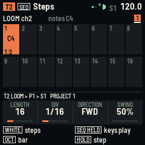
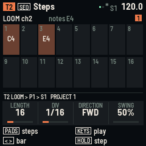

# RELAY-16

RELAY-16 turns the M-VAVE FM-1 or the M-VAVE SMK-37 into a sequencer for other instruments. It makes no sound of its
own. Sixteen tracks play another FM-1 running LOOM-8, a hardware synth or a DAW, over USB, Bluetooth MIDI and, on the
SMK-37, the TRS jack.

Version {{VERSION}}. **Not yet tried on a unit**: it builds for both boards and passes its tests in fm1-base's
simulator. Installing is at your own risk; M-VAVE's updater puts the stock firmware back.

**Install** (Chrome or Edge on a computer, the unit connected by USB):

- [FM-1](install/)
- [SMK-37 Pro](install-smk37/) (and the Starrykey 37 Play)
- [SMK-37 Elite](install-smk37-elite/)
- [MKE-P37](install-smk37-mke/)

**More:**

- [Manual](manual/): every page and control, playing a LOOM-8 FM-1, saving.
- [Try it in the browser](emu/): the FM-1 build, running the same code. Pick a MIDI output in its bar (Chrome or
  Edge) and it plays your synth.
- Download the packages for the command-line installer, `python3 tools/fm1_install.py FILE`:
  [FM-1](firmware/{{PKG}}), [SMK-37 Pro](firmware/relay-16-smk37-{{VERSION}}.fwsc),
  [SMK-37 Elite](firmware/relay-16-smk37-elite-{{VERSION}}.fwsc), [MKE-P37](firmware/relay-16-smk37-mke-{{VERSION}}.fwsc).
- [Source](https://github.com/davidpryan/fm1-relay): MPL-2.0. Built on fm1-base and felucca-bsp, from Felucca by Leo
  Kuroshita, Hügelton Instruments. The SMK-37 board layer is by M. Geisler (genkigenki) and Kerem Kilic (keremimo).

## What it does

- 16 tracks of 8 patterns, up to 64 steps each. Each pattern has its own length, note value, direction and swing.
- A step holds a chord of up to 4 notes, with velocity, length, micro-timing, chance, a condition, ratchets, glide,
  accent and 4 CC locks.
- Each track has a device profile (LOOM-8 synth or kit, GM drums, a drum machine, the stock FM-1, any synth), so its
  CCs and drum lanes have names.
- 16 scenes, a 32-slot song, mutes, solo, fills, live and step recording, Euclid and random generators, undo.
- MIDI clock out or in. USB host for a synth or another FM-1 through a powered hub. Bluetooth MIDI both ways.
- On the SMK-37: the pads are the steps, the keybed plays with velocity, the faders play CC lanes, and the TRS jack
  is MIDI out.
- Four project slots, and a help card for every button: hold it for a second.
- Per-port timing and auto-reconnecting Bluetooth: two LOOM-8s, one wired and one on Bluetooth, play all 16
  tracks in time.

M-VAVE, FM-1 and SMK-37 are trademarks of their owners. RELAY-16 is not affiliated with M-VAVE.
